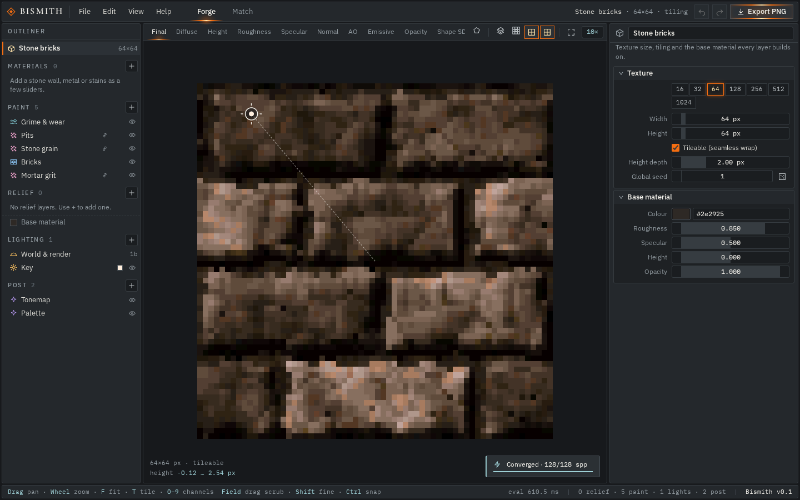

# Bismith

A browser-based **procedural flat-surface texture generator** — retro, palette-based pixel-art walls and floors, and
skeuomorphic UI surfaces (buttons, wells, panels). Layers of procedural operations build Diffuse, Height,
Roughness and Emissive maps (normals are derived from height); a custom path tracer renders them under
configurable lights; a post stack adds glow, tonemapping and 8-bit palettisation.



- Architecture and the guiding brief: [`docs/architecture.md`](docs/architecture.md)
- Feature plans + progress checklists: [`docs/features/`](docs/features/)

## Stack

Vue 3 · Pinia · TypeScript · Vite · Three.js (WebGL2, GLSL 3.00 ES) · Vitest · Playwright (harness).
The UI follows Bismith's own **Cinderforge** design system, a Blender-tempered editor look.

## Getting started

```bash
npm install
npm run dev        # http://localhost:5173
```

Requires a browser with WebGL2 and float render targets (`EXT_color_buffer_float`) — any recent desktop
Chrome, Edge, Firefox or Safari with hardware acceleration.

## Scripts

| Command                    | What it does                                                          |
| -------------------------- | --------------------------------------------------------------------- |
| `npm run dev`              | Vite dev server with HMR                                              |
| `npm run build`            | Type-check (`vue-tsc`) and build to `dist/`                           |
| `npm run typecheck`        | Type-check only                                                       |
| `npm test`                 | Unit tests (Vitest)                                                   |
| `npm run lint`             | oxlint                                                                |
| `npm run harness -- <cmd>` | Headless render / compare / optimise harness (see below)              |
| `npm run presets:manifest` | List `public/presets/` in its `manifest.json` (the build runs it)     |
| `npm run deploy`           | Build and upload `dist/` to the Cloudflare Worker (`tools/deploy.ts`) |

## Using the editor

- **Outliner** (left): the project, the layer stack (top row = top of the stack), lights, post filters. `+` adds,
  drag to reorder, double-click to rename, eye to toggle, lock to protect a layer from the optimiser.
- **Viewport** (centre): `Final` render or any channel (`1`–`8`), wheel zoom, drag to pan, `F` fit, `T` 3×3 tile
  preview, `G` pixel grid, `S` preview the stack up to the selected layer. Drag light gizmos to move lights.
- **Properties** (right): everything about the selection. Number fields scrub on drag (Shift fine, Ctrl snap)
  and accept typed values or expressions on click.
- **File** menu: new / open / save project JSON, export PNG (optionally upscaled), export all maps as a zip.
- **Publish…** (top bar, or File › Publish to gallery): share the project in the
  [Bismith Gallery](https://gallery.bismith.dev) with a 1024 px render of each variant; publish again from the same
  browser to update or remove it. Gallery links open here as `/?gallery=<id>`. (The gallery is its own repo; point a
  local Bismith at a local gallery with `VITE_GALLERY_URL`.)
- **Ctrl+Z / Ctrl+Shift+Z** undo/redo; the project autosaves to local storage.

## Harness (headless)

`tools/harness.ts` starts Vite in-process and drives the app in headless Chromium (`?headless` page,
`window.__bismith` API):

```bash
npm run harness -- render project.json --out harness-out/x.png --samples 64 --maps
npx tsx tools/harness.ts sheet harness-out/sheet.png a.png b.png --scale 3
```

Other tools: `npx tsx tools/smoke.ts` (compile + render every layer/post type), `npx tsx tools/presets.ts`
(render every preset to a contact sheet), `npx tsx tools/shot.ts out.png --eval "…"` (screenshot the editor),
`npx tsx tools/matchbench.ts pairs.json strategy.json --seeds 3` (benchmark the Match optimiser on reference pairs,
scored under the Tile and Texture presets).

See [`docs/features/fr6.2-headless-harness.md`](docs/features/fr6.2-headless-harness.md) for `compare` and
`optimize`. On machines without the NSS libraries Chromium needs (and without root), unpack them locally:

```bash
mkdir -p .cache/debs && cd .cache/debs && apt-get download libnspr4 libnss3 && for f in *.deb; do dpkg -x "$f" ../chromium-libs; done
```

## Layout

```
src/core       project model, params, colour maths, serialisation
src/layers     layer registry, GLSL chunks, generators/, filters/
src/gpu        WebGL plumbing (targets, passes, uniforms, jump flood)
src/render     engine, material pipeline, path tracer, post/, display, export
src/match      similarity metrics + optimiser
src/stores     Pinia stores (project with undo/redo, editor UI state)
src/ui         Cinderforge components, layout, panels
src/presets    starter projects
tools/         harness CLI, PNG helpers, editor screenshot tool
```

## Credits

- **Quake palette** — id Software's `gfx/palette.lmp` (John Carmack has said it can be considered public domain),
  as published in [DarkPlaces](https://github.com/DarkPlacesEngine/darkplaces) and
  [SLADE](https://github.com/sirjuddington/SLADE).
- **Doom palette** — the first PLAYPAL palette of Doom (1993) by id Software, from SLADE's palette set.
- **Other palettes** — PICO-8 (Lexaloffle), Commodore 64 (Philip "Pepto" Timmermann's measured palette), and
  Sweetie 16 by GrafxKid (via [Lospec](https://lospec.com)) as the custom-palette example.
- **VGG-19** (`public/models/`, truncated at conv4_1, float16) — K. Simonyan and A. Zisserman, Visual Geometry
  Group, University of Oxford, [CC BY 4.0](https://creativecommons.org/licenses/by/4.0/); converted from the Keras
  ImageNet weights.
- **Fonts** — IBM Plex Sans, IBM Plex Mono and Cormorant Garamond (SIL Open Font License), via Fontsource.

Quake and Doom are trademarks of id Software; Bismith is not affiliated with or endorsed by id Software.

## License

[MIT with the Commons Clause](LICENSE): you may use, copy, change and share Bismith, but not sell it or offer it as a
paid service. Textures and anything else you make with it are yours to use and sell however you like, commercial or
not, with no attribution needed.
